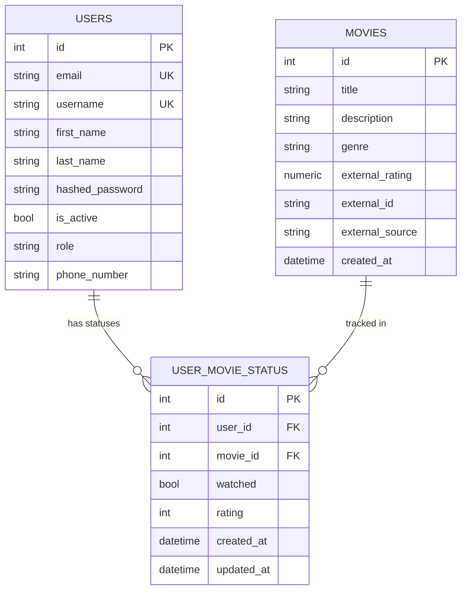

# Entity Relationship Diagram

The app has three tables: one for users, one for the shared movie
catalog, and one for per-user movie status.

## Notes

- `movies` is a shared catalog. It has no owner. One row per movie,
  even if 1000 users track it.
- `user_movie_status` has one row per (user, movie) pair. A missing
  row means the user has not touched the movie yet.
- Both foreign keys use `ON DELETE CASCADE`. Deleting a user removes
  their statuses. Deleting a movie removes statuses for that movie.
- `(user_id, movie_id)` is unique. A user cannot have two statuses
  for the same movie.
